# Houshin Engi Aizouban (PlayStation) English translation v1.0.1

An unofficial fan translation patch for **Aizouban Houshin Engi** (愛蔵版 封神演義).
It contains only the changes to the game's data track, not the game: you need your own
disc image of **Houshin Engi - Aizouban (Japan)** (SLPM-86209), the Redump version.

**[Download the patch (v1.0.1)](https://github.com/suddenlythis/houshin-engi-aizouban-psx-english/releases/tag/v1.0.1)**
 · [How to install](INSTALL.md) · [Checksums](SHA1SUMS.txt)

  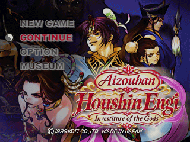

## Progress

Version 1.0.1: everything in the game is translated.

| Area | Status | Details |
|---|---|---|
| English font and text system | Done | A new 6-pixel Latin font. Two English letters are drawn in the space of one Japanese character, so a dialogue line holds 30 letters |
| Story dialogue | Done | Every event scene, battle conversation and camp conversation in all five chapters, including the secret lines: about 3,300 lines |
| Camp and Grotto text | Done | The camp's Thoughts, the immortals' Grottoes, training, challenges and the shop |
| Encyclopedia (Battle Log) | Done | All 458 entries: the story so far, every character, every Paopei |
| Menus and battle interface | Done | Battle commands, skill and status screens, equipment, items, shop, save and load, options, the Museum. Boxes were widened where English needed the room |
| Names | Done | Characters, places, items, skills, Paopei, talismans and terms: about 800 |
| Name entry | Done | An English letter grid replaces the kana grid. Names up to 10 letters |
| Text in pictures | Done | A newly designed English title logo, and redrawn in English: 110 stage banners, the battle start and end cards, status labels, terrain tiles, the gallery and its name plates, icons |
| Movies | Done | English subtitles in the War of Dawn prologue and the four chapter movies, the spoken epilogue subtitled, the opening movie's logo and character names redrawn |
| Memory card | Done | The save title shows in English in the console's memory card screen |
| Voices and staff roll | Not translated | The voice acting stays Japanese, and every voiced line has English text or subtitles. The staff roll is left as it is |
| Tested on | DuckStation | Not tested on other emulators or on real hardware |

## About the game

Houshin Engi is a tactical role-playing game for the PlayStation, loosely based on the
Chinese classic *Fengshen Yanyi* (*Investiture of the Gods*). **Aizouban** ("collector's
edition") is the expanded re-release of the 1998 original.

| | |
|---|---|
| Released | 1 April 1999, Japan only (the original release was 10 September 1998) |
| Publisher | Koei |
| Developer | Fu-Qi (福気) |
| Character design | Takeshi Okazaki |
| Product code | SLPM-86209 |

What Aizouban added, as Koei's own product page lists it: voice acting for the story
scenes, the camp's Thoughts command (つぶやき, the characters' private musings), group battles
at the training Grottoes, PocketStation support and an art gallery of the original designs.

**The story.** The game tells its own story rather than the novel's. Long ago, in the War of
Dawn, humankind defeated the demons, the people of darkness, with the ultimate weapons
called Paopei, and sealed them away. Now the seal has been broken. Demon clouds hang over
the human world, and the once-wise King Chuu of Shou has become a tyrant under the spell of
his consort Dakki. Genshi Tenson of the Konron School sends his disciple Taikoubou down from
the mountain to find out why. With the disgraced general Kou Hiko, the shape-changer Yousen,
the lotus spirit Nata and many others, Taikoubou fights his way through the passes to the
kingdom of Seiki, and then leads its army back to the capital, Chouka, sealing demons into the
Houshin List as he goes.

**How it plays.** Battles take place on rotating 3D maps seen from above. Every character
grows only in the skills and arts they actually use, and terrain is a weapon: arts and Paopei
raise mountains, open pits, flood valleys and change the weather. Between battles the camp
lets you equip the party, raise aptitudes, listen to the characters' Thoughts and send them to
train at the immortals' Grottoes.

## Screenshots

| | |
|---|---|
|  | 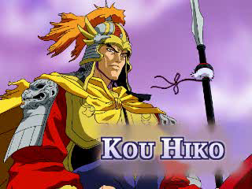 |
| 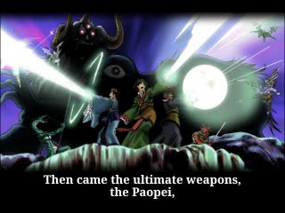 | 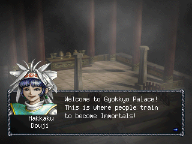 |
| 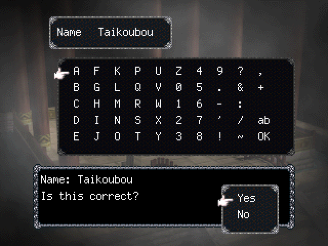 | 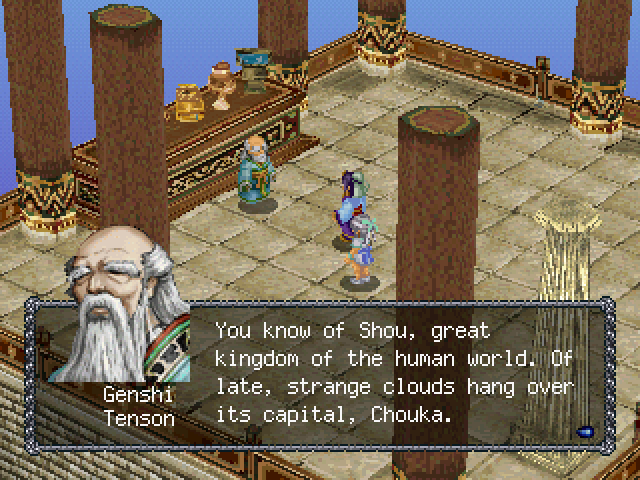 |
| 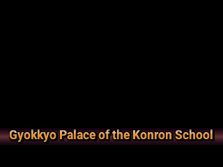 | 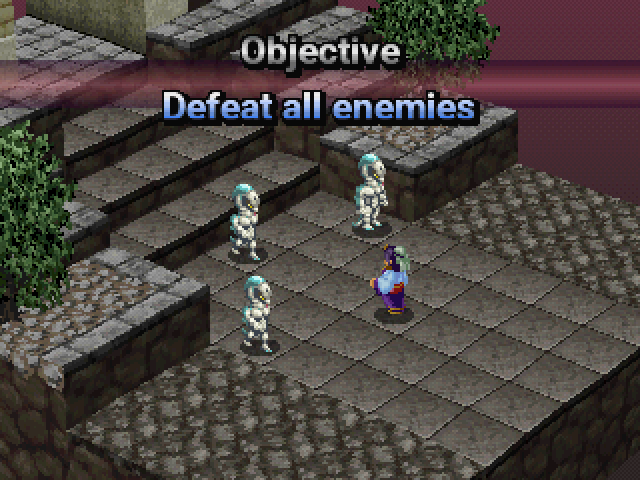 |
| 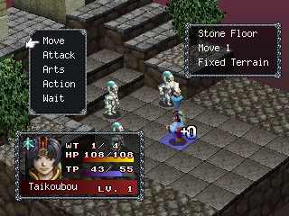 | 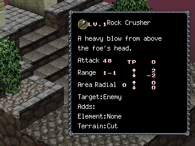 |
| 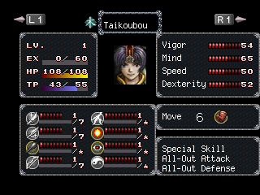 | 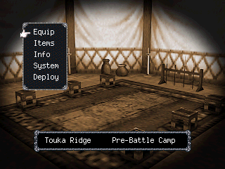 |
| 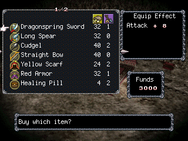 | 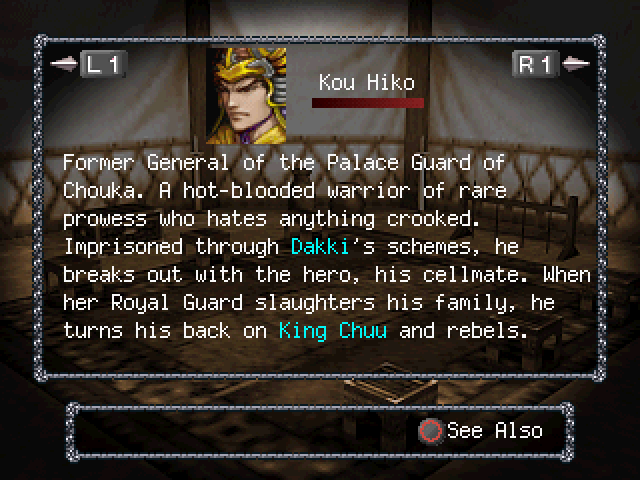 |
| 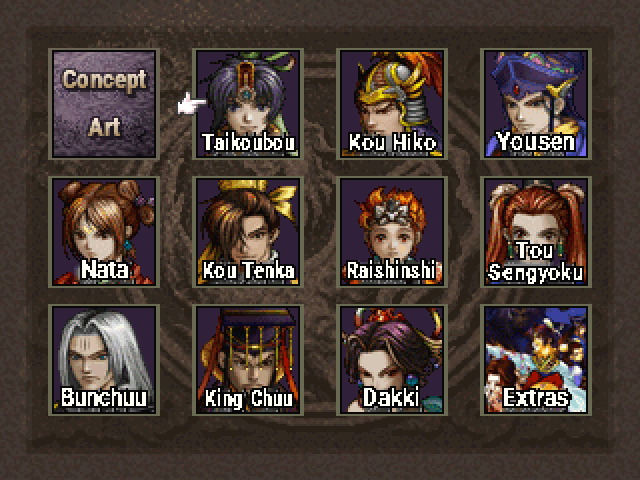 | 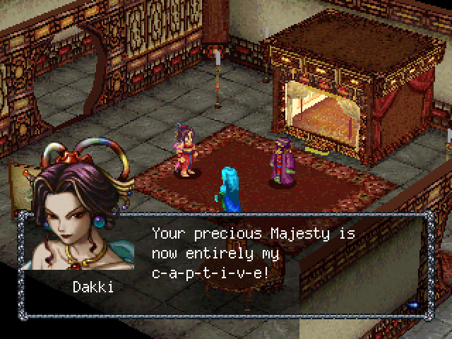 |
| 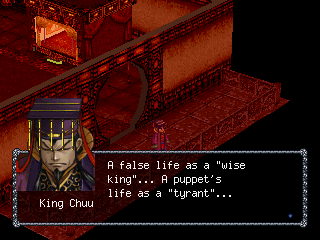 | 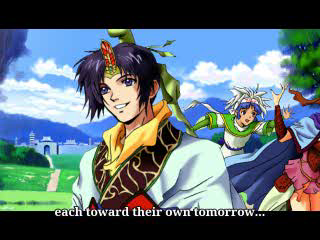 |
| 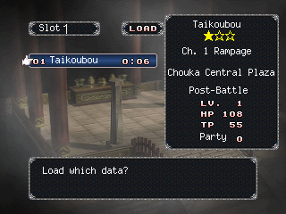 |  |

## Installing

You need the Redump version of the disc, **Houshin Engi - Aizouban (Japan)** (SLPM-86209): one
`.cue` and one `.bin`. The `.bin` must be 363,266,400 bytes with SHA-1 `81351d74a1623f65a83220bf313df4a36a953361`.

Short version: patch the `.bin` with the `.xdelta` file, keep the file name, and open your
usual `.cue`.

The full steps, for Delta Patcher and for the command line, are in [INSTALL.md](INSTALL.md).

Start a new game or load an in-game save after patching, rather than loading a save state made
on the Japanese game.

## About this translation

**The game and the novel.** Houshin Engi is an adaptation of the novel, not a retelling of it.
It borrows the novel's cast and setting but tells its own story and follows its own lore in
places: Bunchuu is a young general rather than the aged Grand Tutor, the enemies are demons
released from an ancient seal, and some characters' roles and relationships differ. The
translation follows the game's version wherever the two disagree.

**Names use their Japanese readings:** Taikoubou, Dakki, Kou Hiko, Nata, Yousen, Bunchuu, King
Chuu, and places such as Chouka, Seiki and the Konron School. This is how the characters say the
names in the voice acting, and how Japanese players know them. The Chinese readings (Jiang
Ziya, Daji, Huang Feihu, Nezha...) are well known from the novel, but using them would put
text on screen that doesn't match what the characters are saying. Long vowels are written
out without macrons ("Taikoubou", not "Taikōbō") so the font needs no special letters.

**Terms.** A few words are kept from the Japanese because they are the game's own vocabulary:
**Paopei** (宝貝), the immortals' magical treasures, written as the game's own furigana reads them,
and **Houshin** (封神). In the game, 封神 means sealing a demon away, so it is translated
as "seal" in the text, and "Houshin!" is kept as the incantation Taikoubou calls out, the way it
is voiced. The scroll that holds the sealed demons is the **Houshin List**. Sects are Schools
(the Konron School, the Kyuuryuu School), and formations are Arrays (the Ten Absolute Arrays).

**Voices and register.** Each character keeps the tone they have in the Japanese. Formal and
dignified characters (Genshi Tenson, Kihatsu, the immortals) speak formally. Rough soldiers,
bandits and the young speak casually, with the odd "gonna" or "ain't" where the Japanese is
just as loose, following the conversational style of Koei's own English releases of the time.
Some characters have habits that carry through the whole script: the tree spirits end their
lines with ", indeed.", Teirin calls everyone "Sir!", Raishinshi speaks of himself as "Rai",
and the Treasure Guardian speaks in halting capitals. Kihatsu is "Your Highness" until he takes
the throne, and "Your Majesty" from then on, as the Japanese changes how he is addressed.

**The title.** The subtitle "Investiture of the Gods" on the title screen is the established
English title of the novel the game is based on. It is there as a recognisable subtitle. In
the game itself, 封神 is "seal".

**Difficulty.** The difficulty settings LIGHT, MIDDLE and HEAVY are left exactly as they are:
the original Japanese game already shows them in English, so these are the developers' own
words.

**PocketStation.** When you save, the game offers two kinds of save: **Save Data**, a normal
save, and **PocketStation**, a save with a small mini-game attached for Sony's PocketStation, a
handheld memory card with its own screen that was sold only in Japan. Playing that mini-game
could earn hard-to-find items. The Japanese calls this option ゲーム付きデータ ("data with a
game attached"). Here it is named after the PocketStation so that it is clear what it is for.
Without a PocketStation, as on most emulators, simply choose Save Data.

**Movies.** The prologue and chapter movies have their Japanese captions burned into the
picture, so the English was drawn into the frames and the movies re-encoded. The epilogue
narration in the ending movie is spoken with no text anywhere on the disc: it was transcribed
with speech recognition, corrected, translated and subtitled.

AI was used to assist with the code and translation.

## What is in English

- All story dialogue: event scenes, battle conversations and camp conversations in all five
  chapters, with each character's voice kept.
- The camp: the Thoughts conversations, the immortals' Grottoes, training, the challenge
  battles against the masters, the Fortune events and the shop.
- The encyclopedia (Battle Log): the story so far, the characters and the Paopei, all 458
  entries.
- Names of characters, places, items, skills, arts, Paopei and talismans, with their
  descriptions.
- Battle screens: the command menu (Move / Attack / Arts / Action / Wait), skill and status
  boxes, terrain information, battle messages, the spoils.
- Menus: equipment, items, aptitude, deployment, save and load, options, the Museum.
- The name-entry screen, as an English letter grid.
- A newly designed English title logo.
- Pictures with text, redrawn in English in the style of the originals: 110 stage banners, the battle start and end cards with every objective, the status labels, the
  terrain tiles, the gallery header and name plates, and the Fortune icons.
- Movies: English subtitles in the War of Dawn prologue and the four chapter movies,
  subtitles for the spoken epilogue, and the opening movie's logo and character names.
- The save title in the console's memory card screen.

## What was changed in the game

Nothing about the rules, the story, the difficulty or the content was changed.

Text
- The game draws Japanese characters from a 12 x 12 font and puts furigana (small reading
  aids) above them. The patch turns the furigana off and replaces the font lookup with a
  routine that draws two letters from a new 6 x 12 Latin font in each character cell. A
  dialogue box now holds four lines of 30 letters.
- Names inserted into text, the hero's name above all, can be any length. The routine carries
  half-filled cells across names and colour changes so there are no gaps.
- Every line is word-wrapped to fit its box, with line lengths balanced so a box doesn't end
  on a single word.
- The scripts, the camp and the encyclopedia grew longer than the Japanese, so they were moved
  into free space on the disc and the game's tables were updated.

Interface
- The speaker's name tag was widened, and long names go on two lines.
- Menus, lists and boxes sized for two or three kanji were widened or rearranged for English:
  the battle command menu, the terrain and skill boxes, the status screen, the equipment, item
  and shop lists, the save and load panel, the camp banner.
- The name-entry screen uses an English grid (A-Z, a-z, digits and symbols), names can be up to
  10 letters, and the reading step (for kanji names) was removed.

Pictures
- Every image with Japanese text was redrawn in English, keeping the original's colours,
  gradients and outlines, and fitted into the original's space.

Movies
- The movies are MDEC video with interleaved audio. The changed frames were decoded, the
  Japanese captions removed, the English drawn in, and the frames encoded again,
  each within its original space on the disc. The audio is untouched.

One bug fixed along the way: the save and load screens copied the location name into a
16-byte buffer. Japanese names always fitted, but long English names overflowed it and froze the
screen. The routine was changed so that any length works.

The same kind of fault was behind the freeze fixed in v1.0.1: the "joined the party" message was
built in a buffer sized for Japanese names, and "Princess Ryuukitsu joined the party!" did not
fit. Every place where the game builds a message this way has now been checked.

## Not translated

- The voice acting and battle cries, which stay Japanese. Every voiced line has English text
  or subtitles.
- The staff roll in the ending movie, left as it is on purpose.
- The developer's Fu-Qi (福気) logo in the opening movie.
- The PocketStation mini-game's own screens, the small pictures shown on the handheld itself.
  Its save title is in English.

## Known issues and limits

- Tested in DuckStation, not on other emulators or on real hardware.
- For about one second of the opening movie the Japanese title glows faintly inside a burst of
  light before the English logo fades in.
- In the opening movie, a soft blur is visible where Dakki's and King Chuu's kanji names were
  removed.
- Two different bosses are both called "Heavenly Lord Chou": their names, 趙 and 張, have
  the same Japanese reading. Each guards a different Array, which his own line names.
- The Treasure Guardian speaks in capitals, but the names inside his lines print in normal case.
- In a few fixed-width lists (the equipment and item lists, the status screen's skill list and
  the camp's character panel) the longest names are shortened with "...", and the full name is
  shown beside them or in the item's own box.

## Technical

- One file of the disc image is changed: the data track. It stays the same size, and sector
  error-correction data is recomputed for every changed sector.
- The patch is made against the Redump image (SHA-1 `81351d74a1623f65a83220bf313df4a36a953361`) and refuses any other file.
- Save states made on the Japanese game keep the old program and text in memory. In-game
  saves on a memory card work with both versions.
- Tested on DuckStation. Not tested on other emulators or on real hardware.

## Version history

| Version | Date | Notes |
|---|---|---|
| v1.0 | 2026-11-22 | First release. Full script, menus, names, encyclopedia, graphics, movie subtitles, English name entry and memory card title |
| v1.0.1 | 2026-11-25 | Fixed a freeze at the start of chapter 3, right after Princess Ryuukitsu joins, and a freeze when opening Auto Battle during a battle. Long names are now safe in the battle unit list and the loss-condition box, and the split deployment screen (Invasion, Divided Army) no longer clips its text. Saves from v1.0 work |

---

This is an unofficial, non-commercial fan work. Houshin Engi and everything in it belong to
their owners. The patch contains no game data that can be used without an original disc image.
